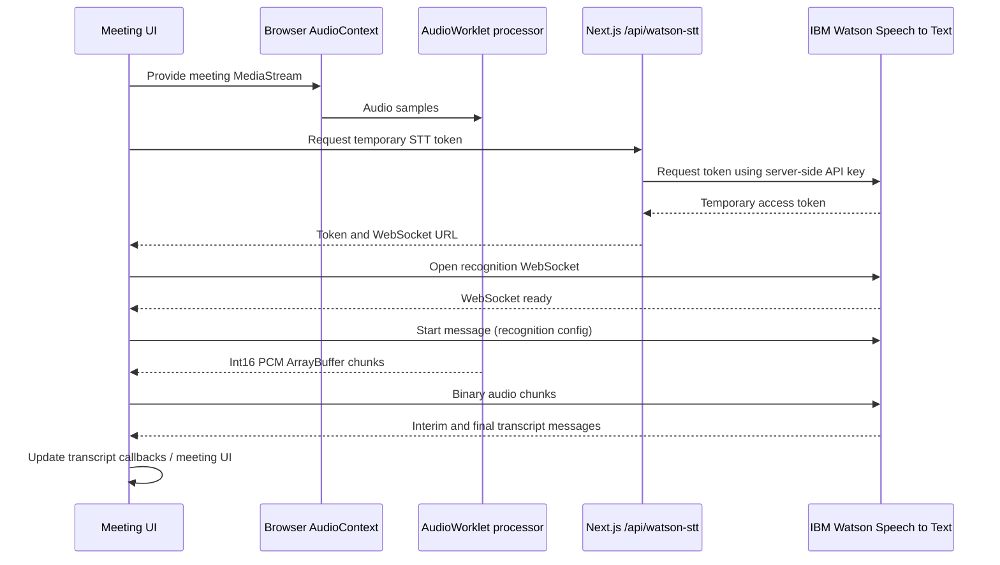
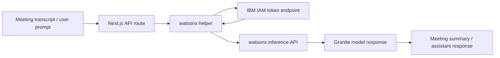

# Novexa architecture notes

## 1. Real-time ASR flow

Implementation references:

- `src/lib/watsonSTT.js` — token retrieval, WebSocket lifecycle, recognition configuration, audio capture, and transcript callbacks.
- `src/app/api/watson-stt/route.js` — server-side token endpoint.
- `public/audio-processor.js` — audio chunking and Float32-to-Int16 conversion.

## 2. Audio representation

The recognition configuration requests `audio/l16;rate=16000;channels=1`. The worklet creates `Int16Array` chunks from Float32 input and posts the underlying `ArrayBuffer` to the main thread. The client sends those buffers as binary WebSocket messages.

The `AudioContext` is constructed with a preferred `sampleRate: 16000`. Browser/device behavior should be checked at runtime; a requested sample rate is not a substitute for verifying the actual context sample rate and resampling behavior.

## 3. AI inference flow

Implementation references:

- `src/lib/watsonx.js` — IAM token exchange and authenticated watsonx request helper.
- `src/app/api/meetings/` — meeting summary, chat, and auto-summary routes.
- `src/app/api/agent/route.js` — agent API route.

## 4. Data and application services

The application uses Next.js API routes and Mongoose/MongoDB for persistence. Meeting and collaboration modules also include Agora, Socket.IO, and WebRTC-related code. Exact runtime topology depends on the deployment configuration and enabled meeting transport.
