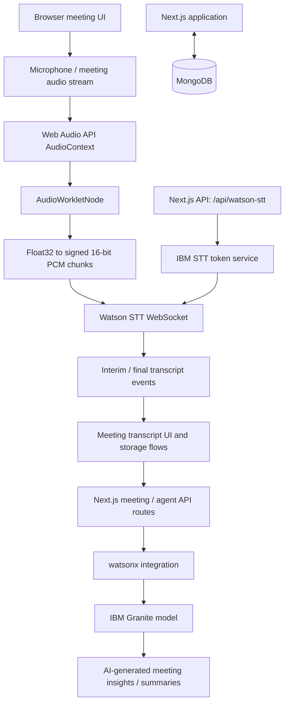

# Novexa — AI-Powered Meeting Intelligence Platform

Novexa is a team collaboration and meeting platform that combines live meetings, speech transcription, and AI-assisted meeting intelligence. The project integrates IBM Watson Speech to Text for speech recognition and IBM watsonx / Granite models for language-model-powered meeting workflows.

> **Project context:** Developed as a five-member team project. This repository is maintained as a personal portfolio copy with permission from the project contributors. See [Team and attribution](#team-and-attribution).


## Highlights

- **Meeting collaboration:** meeting creation/joining and collaboration flows.
- **Speech recognition (ASR):** IBM Watson Speech to Text integration for live meeting transcription.
- **Audio capture and processing:** browser microphone stream, Web Audio API, `AudioWorkletNode`, and Float32-to-Int16 PCM conversion.
- **Live transcription events:** interim and final transcript handling, with confidence/timing data where returned by the service.
- **AI meeting intelligence:** IBM watsonx API integration using Granite models for meeting summaries and related language-model workflows.
- **Team productivity:** chat, goals, check-ins, and team-management modules are present in the application.

## Speech-to-text pipeline

The real-time ASR path is implemented across `src/lib/watsonSTT.js`, `public/audio-processor.js`, and `src/app/api/watson-stt/route.js`:

1. The meeting audio stream is passed to a browser `AudioContext` (configured with a preferred 16 kHz sample rate).
2. An `AudioWorkletNode` loads `public/audio-processor.js` and reads microphone samples.
3. The worklet converts Float32 samples to signed 16-bit PCM chunks and posts the chunk buffers to the main thread.
4. The client obtains a short-lived Watson STT token from the server route and opens a WebSocket connection to IBM Watson Speech to Text.
5. Audio chunks are sent over the WebSocket. The client handles interim and final recognition results and forwards transcript data to the application.

The recognition configuration requests linear PCM audio (`audio/l16`, 16 kHz, mono), interim results, timestamps, and word confidence. Actual capture sample rate can depend on browser/device support; verify the runtime audio context when testing on a new device.

## AI meeting intelligence

The server-side watsonx integration is implemented in `src/lib/watsonx.js` and the meeting/agent API routes. The application obtains an IBM IAM access token using the configured API key, then calls the configured watsonx inference endpoint. The configured model defaults to `ibm/granite-3-3-8b-instruct` and can be overridden through environment variables.

The application uses model responses in meeting summary, auto-summary, meeting chat, and agent-related workflows. Provider credentials remain server-side and must be supplied through environment variables.

## Architecture



This diagram describes the main speech and AI integration path. Other collaboration modules and meeting transports are also present in the codebase.

## Technology stack

| Area | Technologies found in the project |
|---|---|
| Web application | Next.js 15, React 19, JavaScript |
| UI | Chakra UI, Tailwind CSS, Framer Motion, Lucide React |
| Speech / audio | IBM Watson Speech to Text, WebSocket, Web Audio API, AudioWorklet |
| Generative AI | IBM watsonx, IBM Granite |
| Data | MongoDB, Mongoose |
| Meetings / realtime | Agora SDK, Socket.IO, WebRTC-related modules |
| Media / uploads | Cloudinary |
| Authentication | NextAuth |

## Repository structure

```text
.
├── public/
│   ├── audio-processor.js       # AudioWorklet: Float32 -> Int16 PCM chunks
│   └── novexa2.png              # Novexa brand asset
├── src/
│   ├── app/api/                 # Next.js API routes (STT, TTS, watsonx, meetings, etc.)
│   ├── components/              # Meeting and collaboration UI
│   ├── hooks/                   # Meeting, audio and transcription hooks
│   └── lib/
│       ├── watsonSTT.js         # Watson STT token + WebSocket client
│       ├── watsonx.js           # watsonx IAM token + inference helper
│       └── mongodb.js           # MongoDB connection helper
├── server.js                    # Custom Next.js / Socket.IO server
├── .env.example                 # Safe environment-variable template
├── ARCHITECTURE.md              # Architecture and ASR flow notes
└── README.md
```

## Getting started

### Prerequisites

- Node.js compatible with the project's Next.js version (Node.js 20 LTS recommended).
- npm.
- A MongoDB instance.
- IBM Cloud credentials for the Watson Speech to Text and watsonx services used by the features you want to run.
- Optional provider credentials for Cloudinary and Agora where those features are enabled.

### Setup

```bash
git clone https://github.com/<your-username>/novexa-ai-meeting-platform.git
cd novexa-ai-meeting-platform
npm install
cp .env.example .env.local
```

Edit `.env.local` and provide your own values. Do not commit `.env.local`.

### Run locally

```bash
npm run dev
```

The custom development server is configured by `server.js`; the default local URL is `http://localhost:3000`.

### Production build

```bash
npm run build
npm start
```

Some deployment targets may require adapting the custom Socket.IO server and meeting transport configuration. Review `DEPLOYMENT.md` before deploying.

## Environment variables

See [`.env.example`](.env.example) for the variable names referenced by the current source tree. At minimum, configure the database, authentication, and IBM credentials for the features you intend to test. The codebase contains both current and legacy IBM environment-variable names; do not assume every variable is required for every route.

## Screenshots

The uploaded source archive contained a Novexa brand image but no verified application screenshots. Add genuine screenshots captured from a running instance to `screenshots/` before publishing the repository, and update this section. Do not use mockups as evidence of implemented screens.

Suggested captures:

- Dashboard / team workspace
- Meeting room with live transcription
- Transcript and AI-generated meeting summary
- Agent or meeting assistant view

## Security notes

- Never commit `.env`, `.env.local`, credentials, service URLs containing private instance identifiers, or provider deployment notes containing secrets.
- Rotate any credentials that were ever committed, shared in a ZIP, or exposed in chat. Deleting a file from the latest commit does not remove it from Git history.
- Keep IBM API keys, MongoDB credentials, Cloudinary secrets, and NextAuth secrets on the server. Do not prefix secrets with `NEXT_PUBLIC_`.
- Before making this repository public, run a secret scanner and inspect the complete Git diff.

## Team and attribution

Novexa was developed by a five-member team. This personal portfolio repository is published with permission from the contributors. Add the names and GitHub/profile links of the other contributors here, and describe each person's contribution accurately.

### My contribution

Update this section to reflect only the work you personally completed. Based on the project work described for this portfolio, the relevant areas to document are:

- IBM watsonx / Granite integration for AI-powered meeting workflows.
- Speech AI / ASR integration using IBM Watson Speech to Text.
- Audio capture and processing flow using Web Audio API and AudioWorklet, where this was your direct implementation.

Do not claim ownership of teammates' frontend, backend, database, or deployment work unless you personally implemented it.

## Acknowledgements

- IBM Watson Speech to Text and IBM watsonx documentation / services.
- The Novexa project teammates and mentors.
