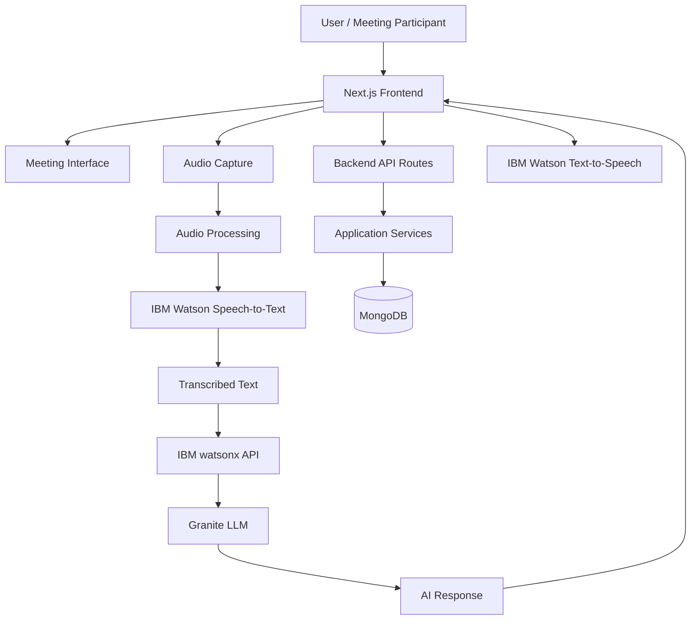

# Novexa – AI-Powered Meeting Platform

An AI-powered meeting and collaboration platform designed to make meetings more productive through intelligent voice processing, AI assistance, and team collaboration.

<p align="center">
  <a href="https://novexa-cyan.vercel.app/"><strong>🚀 Visit Live Application</strong></a>
  &nbsp; | &nbsp;
  <a href="https://youtu.be/zdVjuxpx4rE"><strong>▶ Watch Project Demo</strong></a>
  &nbsp; | &nbsp;
  <a href="https://github.com/dhrupad1304/novexa-ai-meeting-platform"><strong>GitHub Repository</strong></a>
</p>

---

## 🌐 Live Application

**Try Novexa:** https://novexa-cyan.vercel.app/

## 🎥 Project Demonstration

Watch the project demonstration to understand the platform and its functionality.

<p align="center">
  <a href="https://youtu.be/zdVjuxpx4rE">
    
  </a>
</p>

<p align="center">
  <a href="https://youtu.be/zdVjuxpx4rE">Watch the Full Demo on YouTube</a>
</p>

---

## 📌 Overview

Novexa is an AI-powered meeting platform developed to improve how teams communicate, collaborate, and manage meetings.

The platform combines web technologies with IBM watsonx and IBM Watson Speech services to support AI-powered interactions and voice-based functionality.

It brings together speech recognition, AI language model integration, audio processing, and collaborative meeting experiences in a unified application.

Novexa was developed as a collaborative project by a team of five members and was recognized among the **Top 50 Worldwide at IBM TechXchange 2025**.

## ✨ Key Features

- **AI-Powered Meeting Assistance:** Integrates IBM watsonx and Granite LLM capabilities for intelligent AI interactions.
- **Speech-to-Text:** Uses IBM Watson Speech-to-Text to convert voice input into text.
- **Text-to-Speech:** Integrates IBM Watson Text-to-Speech for voice-based responses.
- **Audio Processing:** Captures and processes microphone input through browser audio APIs.
- **Real-Time Audio Streaming:** Uses WebSocket-based communication for speech processing.
- **AI Integration:** Connects application workflows with IBM AI services through API integrations.
- **Collaborative Experience:** Provides a platform for meeting-related interactions and team collaboration.

## 🏗️ System Architecture

The application connects its frontend, API routes, audio-processing components, and IBM AI services.



## 🧠 AI and Voice Processing Pipeline

The AI and voice integration consists of the following stages:

1. **Audio Capture:** Captures microphone input using browser audio APIs.
2. **Audio Processing:** Uses an AudioWorklet to process audio samples and convert floating-point audio data into 16-bit PCM format.
3. **Speech Recognition:** Streams audio to IBM Watson Speech-to-Text through a WebSocket connection.
4. **Transcription:** Receives recognized speech and makes the transcribed text available to the application.
5. **AI Inference:** Integrates with IBM watsonx to generate AI responses using the Granite language model.
6. **Voice Response:** Uses IBM Watson Text-to-Speech to convert text responses into audio.

## 🛠️ Technology Stack

| Category | Technologies |
|---|---|
| Frontend | Next.js, React, JavaScript |
| Backend | Next.js API Routes, Node.js |
| Database | MongoDB |
| AI / LLM | IBM watsonx, IBM Granite |
| Speech Recognition | IBM Watson Speech-to-Text |
| Speech Synthesis | IBM Watson Text-to-Speech |
| Authentication | NextAuth |
| Real-Time Communication | WebSockets, Agora, Socket.IO |
| Media Storage | Cloudinary |
| Deployment | Vercel |
| Development Tools | Git, GitHub, VS Code |

## 📂 Project Structure

```text
novexa-ai-meeting-platform/
│
├── public/
│   └── audio-processor.js
│
├── src/
│   ├── app/
│   │   └── api/
│   │       ├── watson-stt/
│   │       └── tts/
│   │
│   └── lib/
│       ├── watsonSTT.js
│       └── watsonx.js
│
├── screenshots/
│
├── ARCHITECTURE.md
├── DEPLOYMENT.md
├── .env.example
├── .gitignore
├── package.json
└── README.md
```

*Note: This is a simplified representation showing selected project files and directories.*

## ⚙️ Getting Started

Follow these instructions to run the project locally.

### Prerequisites

- Node.js
- npm
- Git
- MongoDB connection
- Required IBM Cloud and watsonx service credentials
- Credentials for other third-party services required by the application

### 1. Clone the Repository

```bash
git clone https://github.com/dhrupad1304/novexa-ai-meeting-platform.git
```

### 2. Navigate to the Project Directory

```bash
cd novexa-ai-meeting-platform
```

### 3. Install Dependencies

```bash
npm install
```

### 4. Configure Environment Variables

Create a local environment configuration file:

```bash
cp .env.example .env.local
```

Add your own valid service credentials and configuration values to `.env.local`.

Refer to `.env.example` for the required environment variable names.

**Important:** Never commit `.env.local`, API keys, database credentials, access tokens, or other sensitive information to GitHub.

### 5. Start the Development Server

```bash
npm run dev
```

Open the application in your browser:

```text
http://localhost:3000
```

Some application features may require valid third-party service credentials and additional configuration.

## 🔐 Security

- Environment variables are used for service configuration.
- `.env.example` contains placeholder values instead of actual credentials.
- Sensitive environment files are excluded using `.gitignore`.
- API keys and database credentials should never be hardcoded or committed to the repository.

## 👨‍💻 My Contribution

Novexa was developed collaboratively by a team of five members.

My primary responsibility focused on **AI integration and IBM watsonx-related functionality**.

My contributions included:

- Integrating IBM watsonx APIs into the application.
- Working with the IBM Granite language model for AI-powered interactions.
- Integrating IBM Watson Speech-to-Text for voice input and transcription.
- Working on browser-based audio processing and WebSocket audio streaming.
- Contributing to the AI voice interaction pipeline.
- Integrating IBM Watson Text-to-Speech functionality.

The project involved collaboration across AI, frontend, and backend development.

## 🏆 Recognition

**IBM TechXchange 2025 – Top 50 Worldwide**

Novexa was developed and presented as part of the IBM TechXchange 2025 initiative.

## 🤝 Team & Acknowledgements

This project was developed collaboratively by a team of five members.

Credit goes to all team members for their contributions across platform design, development, integration, and implementation.

Special thanks to IBM for providing the watsonx and Watson services used in this project.

## 📄 Additional Documentation

- [System Architecture](ARCHITECTURE.md)
- [Deployment Guide](DEPLOYMENT.md)
- [Environment Configuration](.env.example)

## 📬 Connect

**GitHub:** [@dhrupad1304](https://github.com/dhrupad1304)

**Project Repository:** [Novexa AI Meeting Platform](https://github.com/dhrupad1304/novexa-ai-meeting-platform)

**Live Application:** [novexa-cyan.vercel.app](https://novexa-cyan.vercel.app/)

---

<p align="center">
  <strong>Novexa – Making Meetings Smarter with AI.</strong>
</p>
