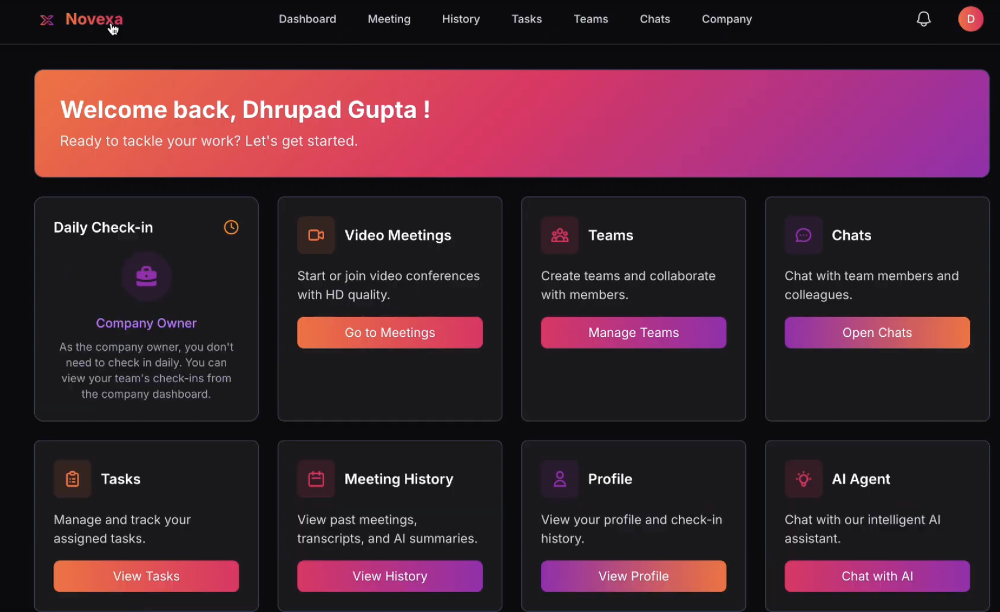
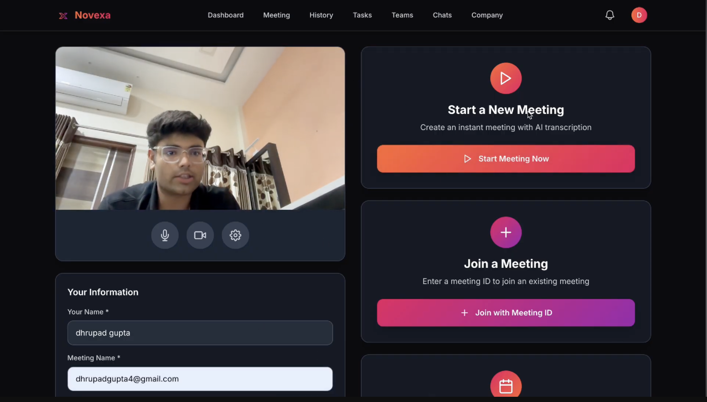
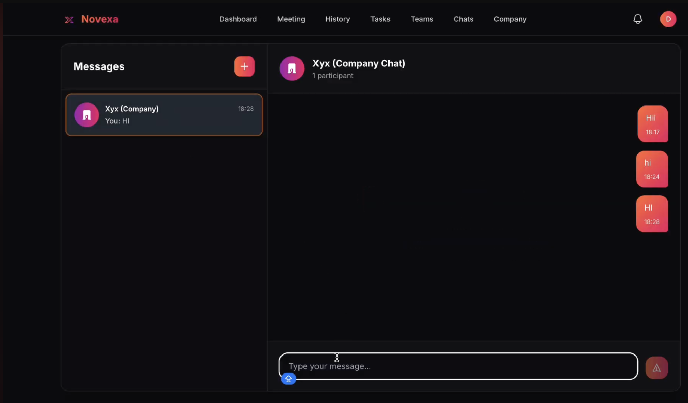
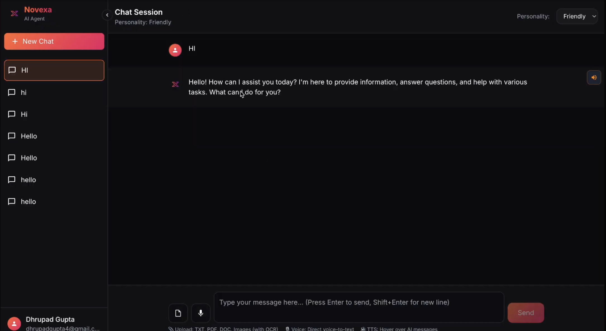
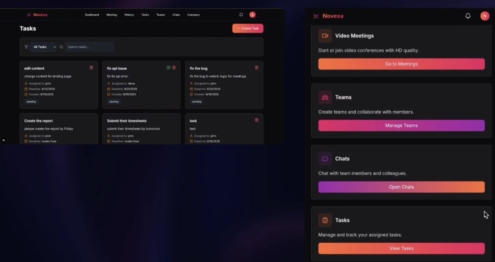
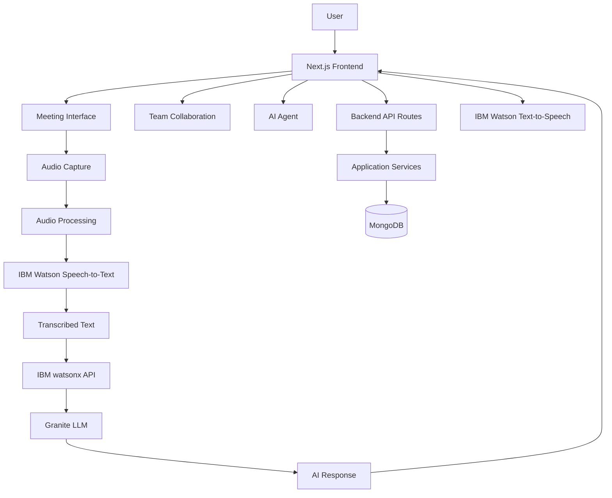

# Novexa – AI-Powered Meeting Platform

An AI-powered meeting and collaboration platform that brings intelligent voice processing, AI assistance, and team communication together in one place.

<p align="center">
  <a href="https://novexa-cyan.vercel.app/"><strong>🚀 Live Application</strong></a>
  &nbsp; | &nbsp;
  <a href="https://youtu.be/zdVjuxpx4rE"><strong>▶ Watch Demo</strong></a>
  &nbsp; | &nbsp;
  <a href="https://github.com/dhrupad1304/novexa-ai-meeting-platform"><strong>GitHub Repository</strong></a>
</p>

---

## 🌐 Live Application

**Explore Novexa:** https://novexa-cyan.vercel.app/

## 🎥 Project Demo

Watch the demonstration of Novexa and explore its application features.

<p align="center">
  <a href="https://youtu.be/zdVjuxpx4rE">
    
  </a>
</p>

<p align="center">
  <a href="https://youtu.be/zdVjuxpx4rE">Watch Full Demo on YouTube</a>
</p>

---

## 🖥️ Application Screenshots

Explore the different interfaces and functionalities of the Novexa platform.

### 1. Dashboard

An overview of the platform, including meetings, teams, chats, tasks, meeting history, and AI assistance.



### 2. Meeting Interface

The meeting interface provides options to start a new meeting, join an existing meeting, and interact through video meetings.



### 3. Team Messaging

An integrated company chat interface for communication and collaboration.



### 4. AI Agent

An AI-powered conversational interface designed to support user interactions.



### 5. Platform Features

Additional application views showcasing task management and collaborative functionality.



---

## 📌 Project Overview

Novexa is an AI-powered meeting and collaboration platform developed to improve how teams communicate, interact, and manage meetings.

The application combines modern web technologies with IBM watsonx and IBM Watson Speech services to enable AI-powered interactions and voice-based functionality.

The project brings together:

- AI-powered interactions using IBM Granite.
- Speech recognition using IBM Watson Speech-to-Text.
- Voice response capabilities using IBM Watson Text-to-Speech.
- Browser-based audio processing.
- Meeting and team collaboration interfaces.

Novexa was developed as a collaborative project by a team of five members and was recognized among the **Top 50 Worldwide at IBM TechXchange 2025**.

## ✨ Key Features

- **AI-Powered Assistance:** Integration with IBM watsonx and Granite language models.
- **Speech-to-Text:** Converts voice input into text using IBM Watson Speech-to-Text.
- **Text-to-Speech:** Supports voice responses through IBM Watson Text-to-Speech.
- **Audio Processing:** Captures and processes microphone input through browser audio APIs.
- **Audio Streaming:** Uses WebSocket communication for speech-processing integration.
- **Team Collaboration:** Provides meeting and team communication interfaces.
- **Meeting Management:** Supports meeting-related interactions through the application.
- **Task Management:** Includes task-related functionality in the platform.

## 🏗️ System Architecture

The following diagram illustrates the high-level integration of the frontend, audio-processing components, backend APIs, and IBM AI services.



## 🧠 AI and Voice Processing Pipeline

The AI and voice integration involves the following stages:

1. **Audio Capture:** Captures microphone input using browser audio APIs.
2. **Audio Processing:** Uses an AudioWorklet to process audio samples and convert floating-point audio data into 16-bit PCM format.
3. **Speech Recognition:** Streams audio to IBM Watson Speech-to-Text through a WebSocket connection.
4. **Transcription:** Receives recognized speech and makes the transcribed text available to the application.
5. **AI Inference:** Integrates with IBM watsonx to generate AI responses using the Granite language model.
6. **Voice Response:** Integrates IBM Watson Text-to-Speech to convert text responses into audio.

## 🛠️ Technology Stack

| Category | Technologies |
|---|---|
| Frontend | Next.js, React, JavaScript |
| Backend | Next.js API Routes, Node.js |
| Database | MongoDB |
| AI / LLM | IBM watsonx, IBM Granite |
| Speech Recognition | IBM Watson Speech-to-Text |
| Speech Synthesis | IBM Watson Text-to-Speech |
| Authentication | NextAuth |
| Real-Time Communication | WebSockets, Agora, Socket.IO |
| Media Storage | Cloudinary |
| Deployment | Vercel |
| Development Tools | Git, GitHub, VS Code |

## 📂 Project Structure

```text
novexa-ai-meeting-platform/
│
├── public/
│   └── audio-processor.js
│
├── src/
│   ├── app/
│   │   └── api/
│   │       ├── watson-stt/
│   │       └── tts/
│   │
│   └── lib/
│       ├── watsonSTT.js
│       └── watsonx.js
│
├── screenshots/
│   ├── dashboard.png
│   ├── meeting.png
│   ├── team-chat.png
│   ├── ai-agent.png
│   └── features.png
│
├── ARCHITECTURE.md
├── DEPLOYMENT.md
├── .env.example
├── .gitignore
├── package.json
└── README.md
```

*Note: This is a simplified representation of selected project files and directories.*

## ⚙️ Getting Started

Follow these instructions to run the project locally.

### Prerequisites

- Node.js
- npm
- Git
- MongoDB connection
- Required IBM Cloud and watsonx service credentials
- Credentials for other third-party services used by the application

### 1. Clone the Repository

```bash
git clone https://github.com/dhrupad1304/novexa-ai-meeting-platform.git
```

### 2. Navigate to the Project Directory

```bash
cd novexa-ai-meeting-platform
```

### 3. Install Dependencies

```bash
npm install
```

### 4. Configure Environment Variables

Create a local environment configuration file:

```bash
cp .env.example .env.local
```

Add your own valid service credentials and configuration values to `.env.local`.

Refer to `.env.example` for the required environment variable names.

**Security note:** Never commit `.env.local`, API keys, database credentials, access tokens, or other sensitive information to GitHub.

### 5. Start the Development Server

```bash
npm run dev
```

Open the application in your browser:

```text
http://localhost:3000
```

Some features may require valid third-party service credentials and additional configuration.

## 🔐 Security

- Environment variables are used for service configuration.
- `.env.example` contains placeholder values rather than actual credentials.
- Sensitive environment files are excluded through `.gitignore`.
- API keys and database credentials should never be hardcoded or committed to the repository.

## 👨‍💻 My Contribution

Novexa was developed collaboratively by a team of five members.

My primary responsibility focused on **AI integration and IBM watsonx-related functionality**.

My contributions included:

- Integrating IBM watsonx APIs into the application.
- Working with the IBM Granite language model for AI-powered interactions.
- Integrating IBM Watson Speech-to-Text for voice input and transcription.
- Working on browser-based audio processing and WebSocket audio streaming.
- Contributing to the AI voice interaction pipeline.
- Integrating IBM Watson Text-to-Speech functionality.

The project involved collaboration across AI, frontend, and backend development.

## 🏆 Recognition

**IBM TechXchange 2025 – Top 50 Worldwide**

Novexa was developed and presented as part of the IBM TechXchange 2025 initiative.

## 🤝 Team & Acknowledgements

This project was developed collaboratively by a team of five members.

Credit goes to all team members for their contributions across platform design, development, integration, and implementation.

Special thanks to IBM for providing the watsonx and Watson services used in this project.

## 📚 Additional Documentation

- [System Architecture](ARCHITECTURE.md)
- [Deployment Guide](DEPLOYMENT.md)
- [Environment Configuration](.env.example)

## 📬 Connect

**GitHub:** [@dhrupad1304](https://github.com/dhrupad1304)

**Project Repository:** [Novexa AI Meeting Platform](https://github.com/dhrupad1304/novexa-ai-meeting-platform)

**Live Application:** [novexa-cyan.vercel.app](https://novexa-cyan.vercel.app/)

---

<p align="center">
  <strong>Novexa – Making Meetings Smarter with AI.</strong>
</p>